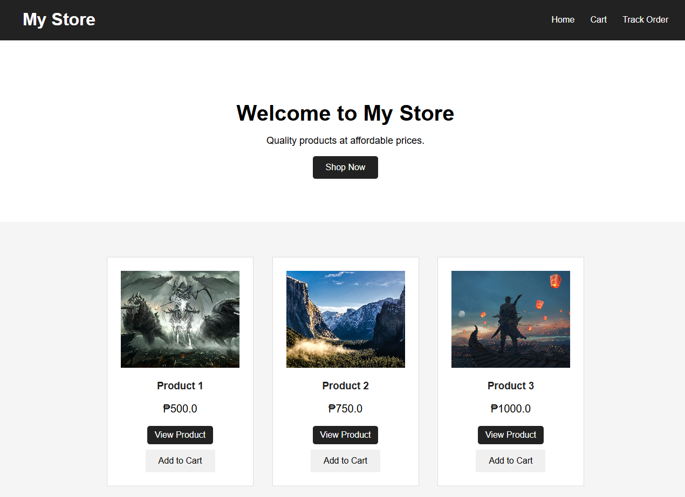
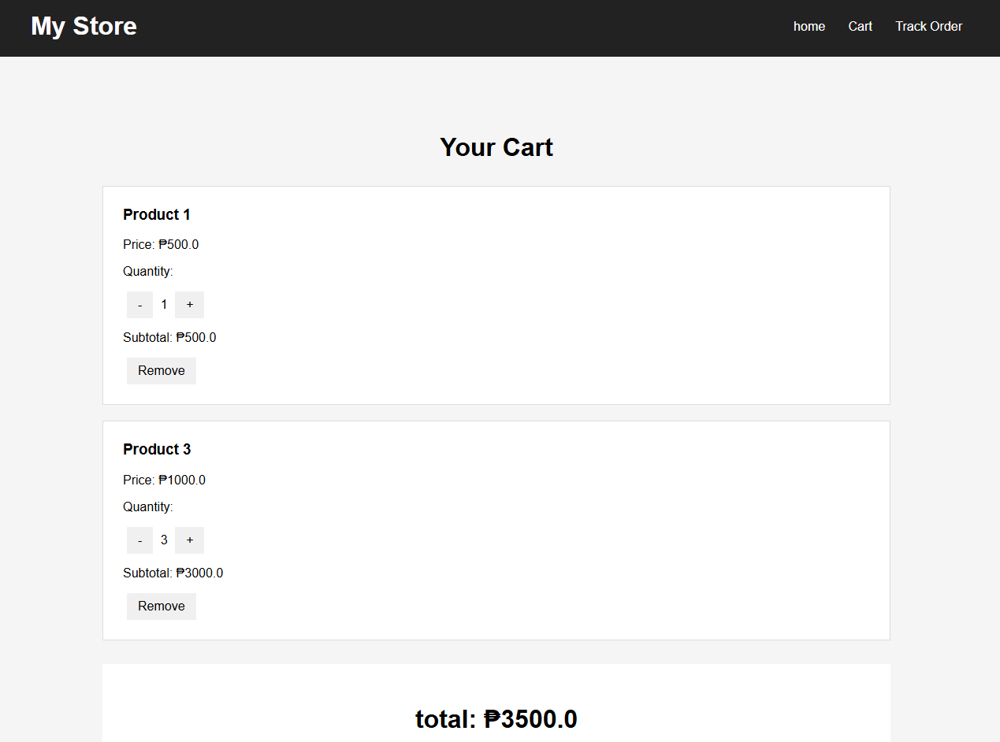
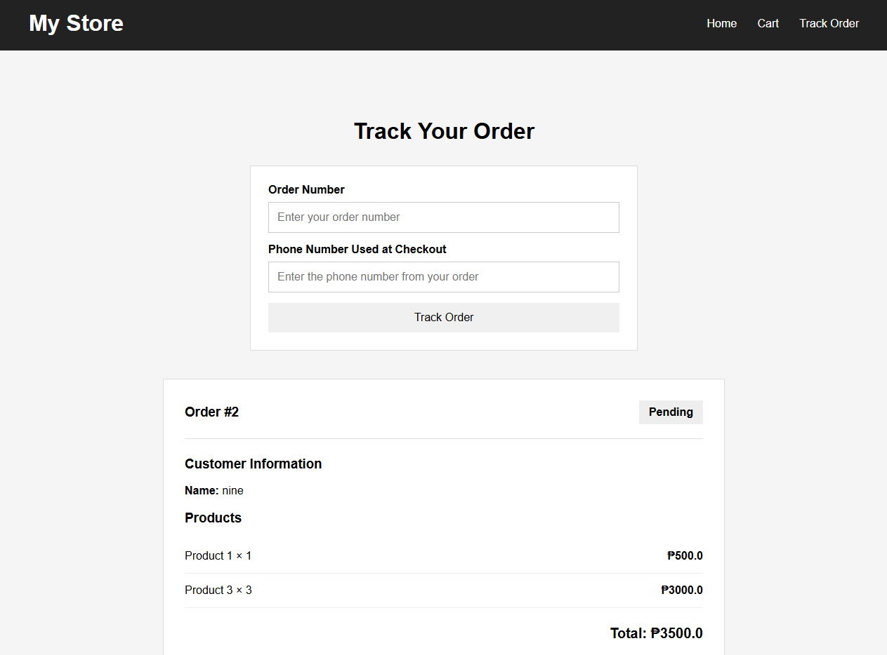

# Store Website

A simple online store built with Flask. Customers can browse products, add them to a cart, place an order, and track it. An admin can log in to view orders and update their status.

Live demo: https://store-website-2niw.onrender.com

## Features

- Product list and product detail pages
- Shopping cart (add, remove, increase, decrease, clear)
- Checkout and order placement
- Order tracking with order ID and phone number
- Admin login, order list, order details, and status update
- CSRF protection on forms
- Admin password stored as a hash, not plain text

## Tech Used

- Python, Flask
- SQLite (local) and PostgreSQL (Render)
- HTML / Jinja templates
- Deployed on Render

## How to run

1. Clone the project: `git clone https://github.com/elcollados/practice-000-store.git`
2. Go into the folder: `cd practice-000-store`
3. Install packages: `pip install -r requirements.txt`
4. Create a `.env` file with: `SECRET_KEY=<any long random text>`
5. Run: `python app.py`
6. Open `http://127.0.0.1:5000`

If `DATABASE_URL` is set, the app uses PostgreSQL. If not, it uses a local SQLite file (`store.db`).

## How This Was Built

- Most of the code was written with AI help (ChatGPT and Claude).
- I retyped the code myself and studied how it works.
- I tested it, fixed errors, and deployed it.

## Learning notes
See [LEARNING.md](LEARNING.md) for what I learned while building this project, I still have a lot of needs to learn, I only added the new word codes that I used in this project.

## Status
Work in progress. Not finished yet.

## Screenshots

